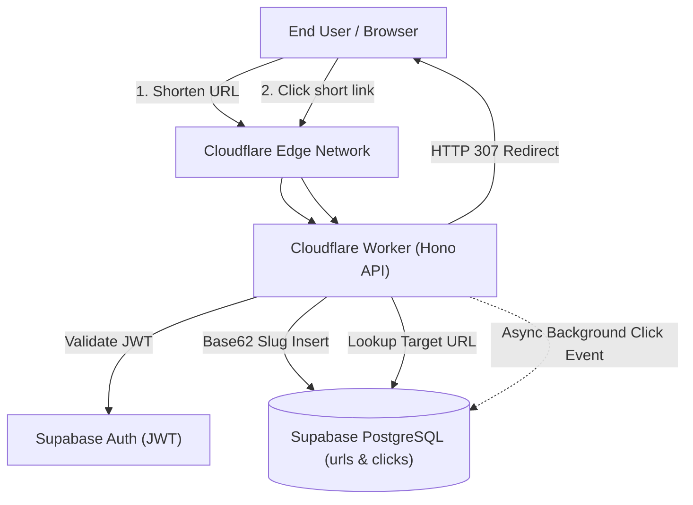

# ⚡ Mini URL

> An ultra-fast, open-source URL shortener, redirect engine, and analytics platform built on **Cloudflare Workers (Hono)**, **PostgreSQL (Supabase)**, and **React (Vite + Tailwind CSS)**.


---

## 🌟 Why Mini URL?

Most link shortener tutorial projects use a slow Node.js/Express server and direct SQL queries with naive MD5 truncation. 
**Mini URL** is built like modern enterprise shorteners (Bitly, Dub, TinyURL):

1. **Edge-Native Redirects (&lt; 15ms):** Cloudflare Workers execute at 300+ data centers globally with zero cold-start delay.
2. **Base62 Collision-Resistant Encoding:** 6-character slugs provide over **56.8 Billion** unique combinations ($62^6$).
3. **HTTP 307 vs. 301 Design:** Avoids permanent browser caching to ensure 100% accurate click analytics.
4. **Non-Blocking Asynchronous Analytics:** Redirects happen instantly while click metadata (country, device, browser, referrer, hashed IP) is written in the background via `executionCtx.waitUntil()`.
5. **SSRF & Abuse Shield:** Blocks private subnets (RFC 1918), loopbacks, and recursive shortening.
6. **100% Free Open Source:** Runs within the permanent free tiers of Cloudflare, Supabase, and GitHub.

---

## 🏗️ System Architecture



---

## 📁 Project Structure

```
Mini URL/
├── backend/                  # Cloudflare Worker API (Hono + TypeScript)
│   ├── src/
│   │   ├── index.ts          # API Router (Shorten, Redirect, Analytics)
│   │   ├── lib/
│   │   │   ├── base62.ts     # Base62 encoder/decoder & slug generator
│   │   │   ├── validator.ts  # URL syntax & SSRF security filter
│   │   │   ├── ratelimit.ts  # Sliding window rate limiter
│   │   │   └── supabase.ts   # Supabase client factory
│   │   └── types.ts          # TypeScript interfaces
│   ├── wrangler.toml         # Cloudflare Worker config
│   └── package.json
├── frontend/                 # Cloudflare Pages SPA (React + Vite + Tailwind)
│   ├── src/
│   │   ├── components/       # UI (ShortenCard, UrlCard, QrModal, AnalyticsModal, AuthModal)
│   │   ├── lib/              # Supabase browser client & API helpers
│   │   └── App.tsx           # Dashboard & Link management
│   └── package.json
└── supabase/
    └── schema.sql            # Copy-paste SQL script for tables, triggers & RLS
```

---

## 🚀 Quickstart Guide

### 1. Database Setup (Supabase)
1. Create a free project at [supabase.com](https://supabase.com).
2. Open **SQL Editor** $\to$ **New Query**.
3. Copy the entire contents of [`supabase/schema.sql`](supabase/schema.sql) and click **Run**.
4. Go to **Project Settings** $\to$ **API** and copy:
   * **Project URL**
   * **`anon` public key**
   * **`service_role` secret key**

### 2. Backend Setup (Cloudflare Worker)
```bash
cd backend
npm install
```
Create a file named `.dev.vars` inside `backend/`:
```env
SUPABASE_URL="https://your-project.supabase.co"
SUPABASE_SERVICE_ROLE_KEY="your-supabase-service-role-key"
FRONTEND_URL="http://localhost:5173"
```
Run the local edge development server:
```bash
npm run dev
# Starts API at http://localhost:8787
```

### 3. Frontend Setup (React / Vite)
```bash
cd frontend
npm install
```
Create a `.env` file inside `frontend/`:
```env
VITE_SUPABASE_URL="https://your-project.supabase.co"
VITE_SUPABASE_ANON_KEY="your-anon-public-key"
VITE_API_URL="http://localhost:8787"
```
Run the frontend:
```bash
npm run dev
# Starts UI at http://localhost:5173
```

---

## 🚢 Free 1-Click Deployment

### Deploy Backend (Cloudflare Workers)
```bash
cd backend
npx wrangler login
npx wrangler secret put SUPABASE_SERVICE_ROLE_KEY
npx wrangler deploy
```

### Deploy Frontend (Cloudflare Pages)
1. Push this repository to **GitHub**.
2. Go to **Cloudflare Dashboard** $\to$ **Workers & Pages** $\to$ **Create application** $\to$ **Pages**.
3. Connect your GitHub repo:
   * **Framework preset:** `Vite`
   * **Build command:** `npm run build`
   * **Build output directory:** `dist`
   * **Root directory:** `frontend`
4. In Environment variables, set:
   * `VITE_SUPABASE_URL`
   * `VITE_SUPABASE_ANON_KEY`
   * `VITE_API_URL` (your deployed worker URL)
5. Click **Save and Deploy**!

---

## 🎓 College Project & Resume Talking Points

* **Base62 vs Hash Truncation:** Demonstrates algorithmic choice over naive MD5 substring truncation to avoid collision bottlenecks.
* **Cache-Aside Pattern:** Fast KV/Memory lookups for hot links with fallback to relational database.
* **Edge Computing:** Uses Cloudflare's serverless V8 isolates to achieve worldwide sub-15ms redirect latency without maintaining virtual machines.
* **Database Security (RLS):** Implements Postgres Row Level Security ensuring user isolation without relying solely on application-layer checks.
